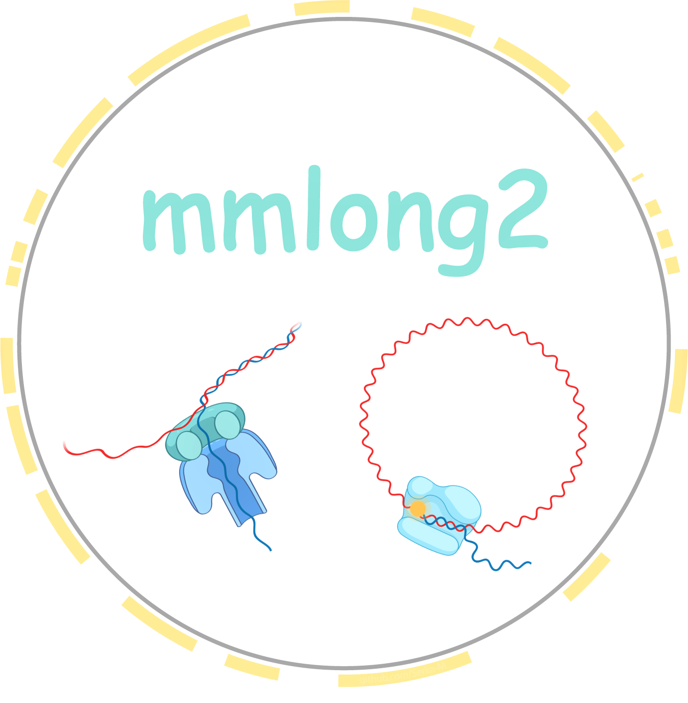
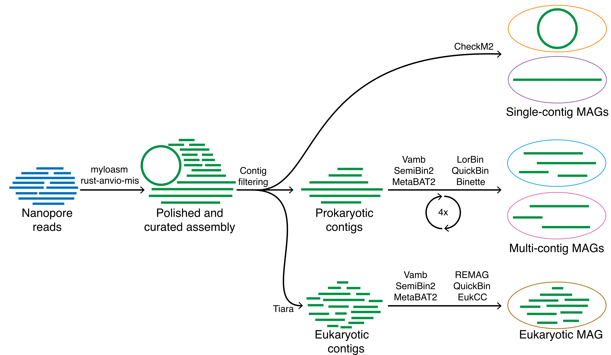

[](https://anaconda.org/bioconda/mmlong2-lite)
[](https://github.com/Serka-M/mmlong2-lite/blob/main/LICENSE)
[](https://doi.org/10.1038/s41564-025-02062-z)

<p align="center">

</p>

Lightweight workflow for microbial genome recovery using either Nanopore or PacBio HiFi reads. <br/>
mmlong2-lite is the microbial genome production part of the [mmlong2](https://github.com/Serka-M/mmlong2) pipeline.
<br/>

## Workflow description
### Core features
* [Snakemake](https://snakemake.readthedocs.io) workflow running dependencies from a [Singularity](https://docs.sylabs.io/guides/latest/user-guide/) container for enhanced reproducibility
* Bioinformatics tool and parameter optimizations for high complexity metagenomics samples
* Automated metagenomic assembly curation for identification and removal of misassemblies
* Circular microbial genome extraction as separate genome bins
* Binning of prokaryotic and eukaryotic metagenome assembled genomes
* Differential coverage support for improved microbial genome recovery
* Iterative ensemble binning strategy for improved genome recovery

### Schematic overview of workflow example

<br/>

## Installation
### Bioconda
The mmlong2-lite workflow is available through [Bioconda](https://bioconda.github.io/):
```
conda create -c conda-forge -c bioconda mmlong2-lite
```

### From source (Conda) 
To create a local [Conda](https://docs.conda.io/projects/conda/en/latest/user-guide/install/linux.html) environment for running mmlong2-lite workflow, just copy-paste the following:
```
conda create --prefix mmlong2-lite -c conda-forge -c bioconda snakemake=9.9.0 singularity=3.8.6 zenodo_get pv pigz tar -y
conda activate ./mmlong2-lite || source activate ./mmlong2-lite 
git clone https://github.com/Serka-M/mmlong2-lite/ $CONDA_PREFIX/lib
ln -s $CONDA_PREFIX/lib/mmlong2-lite/src/mmlong2-lite.sh $CONDA_PREFIX/bin/mmlong2-lite
chmod +x $CONDA_PREFIX/bin/mmlong2-lite
mmlong2-lite -h
```
<br/>

## Running mmlong2-lite
### Quick start
After setting up the virtual environment, it is highly recommended to first perform an initial dry run with a test dataset to ensure that the required software dependencies are correctly installed:
```
zenodo_get -r 24127832 -v 3
mmlong2-lite -np mmlong2_np_prok_euk.fastq.gz -n 
```

After the installation is confirmed, a test workflow run for prokaryotic and eukaryotic genome recovery is recommended:
```
mmlong2-lite -np mmlong2_np_prok_euk.fastq.gz -o testrun -p 32 -euk
```

### Full usage
```
MAIN SETTINGS:
-np     --nanopore_reads        Path to Nanopore reads (default: none)
-pb     --pacbio_reads          Path to PacBio HiFi reads (default: none)
-o      --output_dir            Output directory name (default: mmlong2)
-p      --processes             Number of processes/multi-threading (default: 3)

OPTIONAL SETTINGS:
-bin    --binning_mode          Run pipeline with a specified prokaryote binning mode (e.g. fast default extended)
-cov    --coverage              CSV dataframe for differential coverage binning (e.g. NP/PB/IL,/path/to/reads.fastq)
-run    --run_until             Run pipeline until a specified stage completes
-tmp    --temporary_dir         Directory for temporary files (default: )
-fly    --use_metaflye          Use metaFlye for metagenomic assembly (default: use myloasm)
-dbg    --use_metamdbg          Use metaMDBG for metagenomic assembly (default: use myloasm)
-myl    --use_myloasm           Use myloasm for metagenomic assembly
-ca     --custom_assembly       Use a custom assembly (default: use myloasm)
-cai    --custom_assembly_info  Optional assembly information file (metaFlye format) for custom assembly
-med    --use_medaka            Use Medaka for polishing Nanopore assemblies (default: skip Medaka)
-mm     --medaka_model          Medaka polishing model (default: r1041_e82_400bps_sup_v5.0.0)
-scr    --skip_curation         Skip assembly curation and removal of misassemblies (default: run curation)
-srn    --skip_rename           Skip renaming contigs to output name (default: rename contigs)
-who    --use_whokaryote        Use Whokaryote for identifying eukaryotic contigs (default: use Tiara)
-sef    --skip_eukfilt          Skip filtering of eukaryotic contigs (default: run eukaryote filter)
-sem    --semibin_model         Binning model for SemiBin (default: global)
-mcl    --min_contig_len        Minimum contig length for binning (default: 3000 bp)
-mpc    --min_prok_cov          Minimum contig coverage for prokaryote binning (default: 0)
-mlp    --min_len_prok          Minimum prokaryotic bin size (default: 250000 bp)
-lrb    --use_lorbin            Use LorBin over COMEBin for iterative binning (default: use COMEBin)
-scl    --skip_cleanup          Skip cleanup of workflow intermediate files
-env    --conda_envs_only       Use conda environments instead of container (default: use container)
-h      --help                  Print help information
-v      --version               Print workflow version number

EUKARYOTE BINNING SETTINGS:
-euk    --bin_eukaryote         Run eukaryotic bin recovery (default: skip eukaryote recovery)
-spk    --skip_prokaryote       Skip prokaryotic bin recovery (default: run prokaryote recovery)
-mec    --min_euk_cov           Minimum contig coverage for eukaryote binning (default: 0)
-mle    --min_len_euk           Minimum eukaryotic bin size (default: 2000000 bp)
-mce    --min_compl_euk         Minimum eukaryotic bin completness by EukCC (default: 30%)
-sme    --skip_metabat2_euk     Skip MetaBAT2 binner for eukaryote binning (default: run MetaBAT2)
-sqe    --skip_quickbin_euk     Skip QuickBin binner for eukaryote binning (default: run QuickBin)
-sve    --skip_vamb_euk         Skip VAMB binner for eukaryote binning (default: run VAMB)
-sse    --skip_semibin2_euk     Skip SemiBin2 binner for eukaryote binning (default: run SemiBin2)
-sre    --skip_remag_euk        Skip REMAG binner for eukaryote binning (default: run REMAG)

ADVANCED SETTINGS:
-n      --dryrun                Print summary of jobs for the Snakemake workflow
-t      --touch                 Touch Snakemake output files
-r      --rule                  Run specified Snakemake rule
-x      --extra_inputs          Extra inputs for Snakemake config file
-xa     --extra_asm             Extra inputs for assembler (comma-separated)
-xbp    --extra_bind_path       Extra bind paths for container (default: none)
```

### Using differential coverage binning
To perform genome recovery with differential coverage, prepare a 2-column comma-separated dataframe, indicating the additional read datatype (`NP` for Nanopore, `PB` for PacBio, `IL` for short reads) and read file location.<br/>
Dataframe example:
```
PB,/path/to/your/reads/file1.fastq
NP,/path/to/your/reads/file2.fastq
IL,/path/to/your/reads/file3.fastq.gz
```
The prepared dataframe can be provided to the workflow through the `-cov` option.

### Overview of main output (results directory)
* `<output_name>_assembly.fasta` - metagenome assembly file
* `<output_name>_bins_prok.tsv` - per-bin dataframe for the recovered prokaryotic genomes
* `<output_name>_bins_euk.tsv` - per-bin dataframe for the recovered eukaryotic genomes
* `<output_name>_usage.tsv` - dataframe for compute resource usage
* `dependencies.csv`- list of dependencies used and their versions
* `bins_prok` - directory for prokaryotic metagenome assembled genomes
* `bins_euk` - directory for eukaryotic metagenome assembled genomes

### Additional documentation
* [Dataframe description](msc/mmlong2-lite-dfs.md)
* [Dependency list](msc/mmlong2-lite-dep.md)

## Citation
If you use mmlong2-lite in a publication, please cite:
> Sereika, M., Mussig, A.J., Jiang, C. et al. Genome-resolved long-read sequencing expands known microbial diversity across terrestrial habitats. Nat Microbiol (2025). [https://doi.org/10.1038/s41564-025-02062-z](https://doi.org/10.1038/s41564-025-02062-z)

[//]: # (Written by Mantas Sereika)
